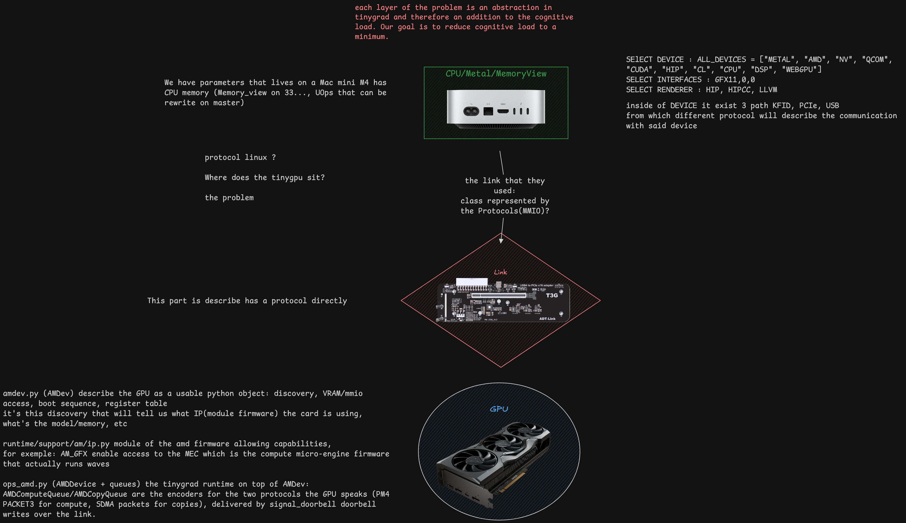

# UT3G
just a repo where i store information about the [UT3G](https://www.adt.link/product/UT3G.html)
in the future, the idea would be to have multiple GPU, with different eGPU board, that shard model.
why not a 9070xtx with 32GB and a tinygrad chesnut

## Install
Start by setting up [Tinygrad](https://github.com/tinygrad/tinygrad)

Then we want to install [TinyGPU](https://docs.tinygrad.org/tinygpu/)

With the 7900xtx we use [ENV](https://docs.tinygrad.org/developer/am/#environment-variables)

### Problem
Since commit `33cd373ad` all the hardware specifique part of my setup has been depreceted
Mooved from `system.py` to `extra/hcq1/`

`git checkout 33cd373ad` keeps our tinygrad version working with tinygpu
or `git checkout -b $NEW_BRANCH 33cd373ad` to create a new branch from this commit

we want to understand each part that is involved in our setup
and make it work on (master) to use VIZ, SHARD, and other tools

One load directly the weight in the card(tinyagent), master is representing it as a UOps.
i do not understand how we can represent the parameters/weight on DISK correctly, has UOps.

    │ Allocator's internal staging ring (self.b) + _copyin/     │ Staging as a graph node: stage = UOp.alloc(..., device=dev.host)
    │ _copyout                                                  │ (hcq2.py:170)
    ├───────────────────────────────────────────────────────────┼──────────────────────────────────────────────────────────────────
    │ CPU memcpy through .cpu_view() window                     │ Enqueued SDMA copy reading the stage via GPUVM
    ├───────────────────────────────────────────────────────────┼──────────────────────────────────────────────────────────────────
    │ TCP-remote peer: CPU:host:port with .remote =             │ Same HostAllocator._alloc hook (device.py:302)
    │ RemotePCIDevice                                           │

[code_map.md] follow the software part
[code_trace.md] are logs
[theory.md]
[deepwikitrace.md]


### Commands

The actuall `DEV` for our setup is `DEV=PCI+AMD:HIP:gfx1100`
`PCI` which is how we talk with the `AMD` device, `HIP` is the renderer(compiler), `gfx1100` which is the target architecture

```sh
DEV=AMD:HIP uv run python3 -m tinygrad.device
uv run python -c "from tinygrad import Device; print(Device.DEFAULT)"
```

list mac driver extension
```sh
systemextensionsctl list
```

```sh
system_profiler SPPCIDataType
system_profiler SPThunderboltDataType
```
